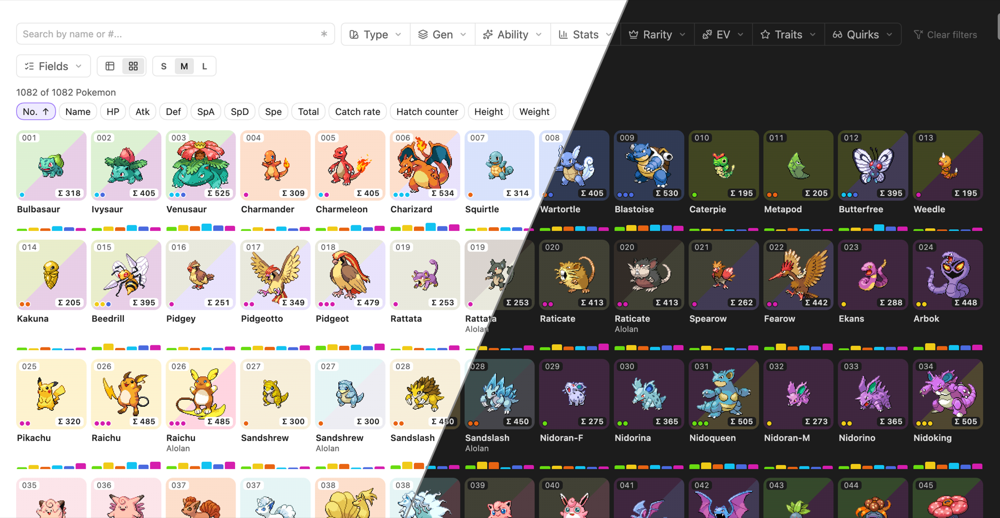
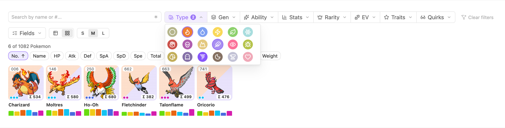
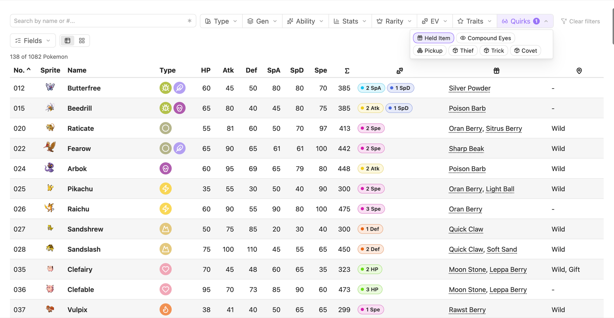
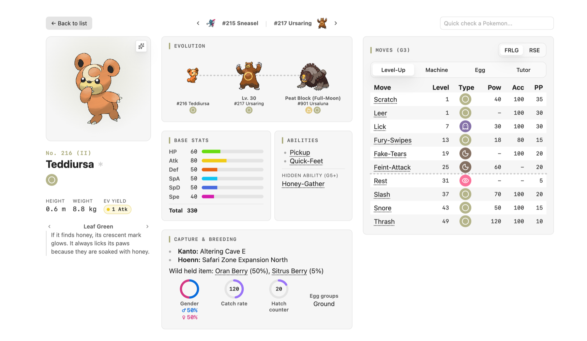
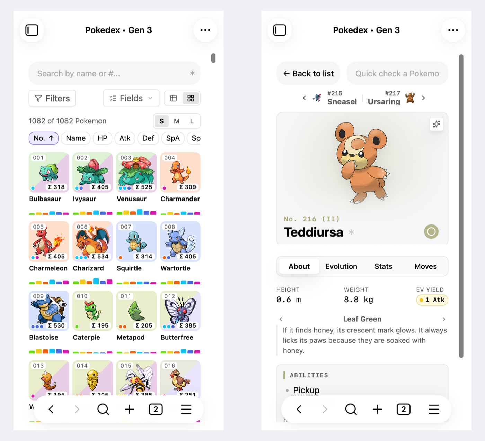

# Pokedex

**Every Pokemon, Gen 1–9, inside Obsidian.** Browse, filter, and inspect the full National Dex (1082 entries, regional forms and Megas included) from a pane in your vault, powered by [PokeAPI](https://pokeapi.co/).



## Find the one you want

Filter by Type, Generation, Ability, Stats, Rarity, EV yield, and Traits or Quirks; combine as many as you like. Here, Fire and Flying leaves six Pokemon out of 1082. Quick search takes a name or a number and works from the keyboard.



## Table or cards

Switch between a sortable **table** and a **card grid** from the toolbar. Choose which Fields the table shows as columns; cards come in three sizes and show the value the list is sorted by.

The screenshot below is set to Gen 3 with the Held Item quirk on, so every row has an item, and the Held item and Capture columns are switched on. Both are off by default. Held items come from Gen 3 to 7 and Capture locations from Gen 3 to 8; the default Active gen, Gen 9, has neither in PokeAPI, so those two columns read "-" there.



## Everything on one screen

The detail screen puts the evolution chain, base stats, abilities, capture and breeding data, flavor text, and a move browser side by side. Hover any move, ability, or item for its description.



## On your phone

Obsidian mobile gets the same Pokedex, laid out for a narrow screen: Card view as the list, and a detail screen split into About, Evolution, Stats and Moves tabs. The screenshots are Obsidian's mobile emulation at 390 × 844, not a real device.



## Features

- **Sortable, filterable table**, with columns you choose.
- **Card view**, remembered per pane width. Tap a tile for a panel with every Field.
- **Favourites.** Star a Pokemon on its detail screen; favourites are marked in both lists and toggled by right-click or press and hold.
- **Mobile and narrow panes.** Runs on Obsidian mobile; a narrow pane gets a compact toolbar, a sideways-scrolling table with No. and Name pinned, and a detail screen laid out for its width.
- **Move browser** with per-version move-list toggles (S/V, Legends: Z-A, Champions).
- **Mega Evolution and Gigantamax.** Toggle alternate forms where available, including split Mega X/Y variants and Legends: Z-A Megas.
- **Regional forms.** Alolan, Galarian, Hisuian, and Paldean forms appear alongside their base species.
- **Shiny toggle** on sprites and artwork.
- **View history** with prev/next navigation between viewed Pokemon.
- **Reduce motion** setting, also following the OS preference.
- **Per-generation caching.** Prefetch, refresh, or delete cached data per generation from the settings tab.

## Disclosures

- **Network use**: this plugin fetches Pokemon data, sprites, and artwork from `pokeapi.co` (a free, public, third-party API) on demand. No other network requests are made.
- **Caching**: fetched JSON and images are cached in a per-device IndexedDB database so repeat browsing doesn't re-fetch from PokeAPI. Nothing is written to your vault, and the cache does not sync between devices. Versions before 0.2.0 cached to a `cache` folder inside the plugin's folder; it is deleted once on first start after updating.
- **No telemetry**: this plugin does not collect or transmit any usage analytics.
- **No account or payment required.**
- **No ads.**
- Source is fully open (this repository).

## Usage

Open the Pokedex view via the ribbon icon or the "Pokedex: Open" command. Configure which generations to browse, sprite style, grid density, and cache in the plugin settings tab.

## Installation

Not on the community plugin store. Either:

- **Manual:** download `main.js`, `styles.css`, and `manifest.json` from a [release](https://github.com/lhak1341/obsidian-pokedex/releases) into `<vault>/.obsidian/plugins/lhak-pokedex/`, then enable it in Obsidian's Community Plugins settings.
- **BRAT:** add this repo to [Obsidian42 - BRAT](https://github.com/TfTHacker/obsidian42-brat) as a beta plugin.

## Development

```bash
bun install
bun run check     # typecheck + lint + tests: the gate CI and releases run
bun run test      # vitest
bun run typecheck # svelte-check
bun run build     # production bundle (esbuild only; it does not typecheck)
bun run deploy    # typecheck + build + copy into the configured test/live vaults
```

See [CLAUDE.md](./CLAUDE.md) for architecture notes and gotchas if you're working on this plugin.

## License

MIT, © 2026 lhak1341. See [LICENSE](./LICENSE).
